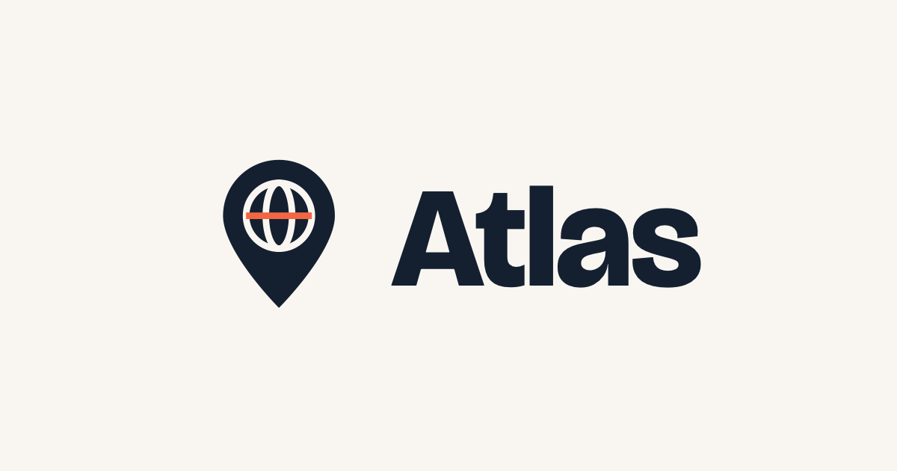

<p align="center">
  
</p>

<p align="center">
  <b>Gizli yeri bul.</b> Her tahmin haritayı sıcak–soğuk renklerle boyar.<br>
  <a href="https://atlas-bulmaca.vercel.app">atlas-bulmaca.vercel.app</a> adresinden hemen oyna.
</p>

---

**Atlas**, [Globle](https://globle-game.com) oyununun Türkçe sürümü. Her gün bir il ya da ülke gizlenir. Bir yer adı yazarsın; o yer haritada, gizli yere ne kadar yakınsa o kadar **sıcak** (koyu kırmızı), ne kadar uzaksa o kadar **soğuk** (soluk krem) renge boyanır. Renklere bakarak yaklaşır, en az tahminle gizli yeri bulmaya çalışırsın.

## Nasıl oynanır?

1. Bir kategori seç: Türkiye'nin illeri, bir kıta ya da bütün dünya.
2. Bir yer adı yaz. Yer haritada belirir, kamera oraya uçar.
3. Renk, iki yerin **en yakın sınırları** arasındaki mesafeyi gösterir. Komşu bir yer 0 km sayılır ve en koyu rengi alır.
4. Takıldığında **ipucu** al. Her turda 3 ipucu var; ilki en genel, sonuncusu en belirgin olanı.
5. Gizli yeri bulunca konfeti patlar, puan kazanırsın ve sonucu arkadaşlarınla paylaşabilirsin.

## Özellikler

- **8 kategori:** Türkiye (81 il), Avrupa, Asya, Afrika, Kuzey Amerika, Güney Amerika, Okyanusya ve Dünya (200 ülke).
- **Günlük bulmaca ve alıştırma:** Her kategoride herkes aynı gün aynı yeri arar. Alıştırma modunda istediğin kadar oynayabilirsin.
- **3D küre:** Dünya kategorisi döndürülebilen bir kürede oynanır, diğer kategoriler düz haritada.
- **Akıllı harita:** Tahmin ettiğin yerlerin adı haritaya yazılır, çakışan adlar boş bir yere kayar. Küçük ülkeler ve adalar nokta olarak işaretlenir.
- **Puan ve seviyeler:** Az tahminle ve ipucusuz kazanmak, günlük bulmacayı çözmek ve zor kategorilerde oynamak daha çok XP kazandırır.
- **İstatistikler:** Kazanma oranı, seri, tahmin dağılımı, son 18 haftanın takvimi, gelişim grafiği ve keşfettiğin yerleri gösteren bir harita.
- **6 dil:** Türkçe, İngilizce, Almanca, Fransızca, İspanyolca, İtalyanca. Ülke adları her dilde aranabilir.
- **Açık ve koyu tema**, azaltılmış hareket desteği.

## Platformlar

Aynı oyun dört yerde oynanır:

| Platform | Teknoloji |
|---|---|
| 🌐 **Web** | Saf JavaScript, derleme adımı yok. Vercel'de yayında, telefona uygulama gibi eklenebilir (PWA). |
| 💻 **macOS** | SwiftUI (macOS 14+) |
| 📱 **iPhone** | SwiftUI (iOS 17+), Mac ile aynı kod |
| 📺 **Apple TV** | SwiftUI (tvOS 17+), kumandayla oynamaya uygun arayüz |

### Apple TV + iPhone: sesle tahmin

Apple TV'de iPhone mikrofon olarak kullanılır. iPhone'daki Atlas'ta **"TV'ye söyle"** sayfasını aç, düğmeye basılı tutup yer adını söyle; tahmin doğrudan TV'ye gider. Telefondan ipucu alabilir, kategori değiştirebilir, yeni oyun başlatabilir ya da pes edebilirsin. İki cihaz aynı ağda Bonjour ile birbirini bulur.

## Proje yapısı

```
Atlas/            Swift kodu (macOS, iOS ve tvOS ortak)
  Models/         Yerler, kategoriler, ipuçları, çeviriler
  Game/           Oyun durumu, günlük bulmaca, istatistik, puan
  Views/          Harita, küre, paneller, pencereler, TV arayüzü
  Voice/          iPhone ↔ Apple TV ses bağlantısı
  Resources/      İller, ülkeler, mesafe matrisleri, metinler, ipuçları
web/              Web sürümü (HTML, CSS, JS; veri dosyaları Resources'un kopyası)
tools/            Veri üretimi (Python/Swift), ikon üretimi, web test aracı
project.yml       Xcode projesinin xcodegen tanımı
```

## Çalıştırma

```sh
# Web: yerelde dene
cd web && python3 -m http.server 8765    # → http://127.0.0.1:8765

# macOS: Xcode projesini üret, derle, aç
xcodegen generate
xcodebuild -project Atlas.xcodeproj -scheme Atlas -configuration Debug -derivedDataPath build build
open build/Build/Products/Debug/Atlas.app
```

iPhone (`AtlasiOS`) ve Apple TV (`AtlasTV`) şemaları da aynı projede. Cihaza yüklemek için bir Apple geliştirici hesabıyla imzalamak gerekir.

## Veri

- **Haritalar:** [Natural Earth](https://www.naturalearthdata.com) 1:50m (ülkeler), [cihadturhan/tr-geojson](https://github.com/cihadturhan/tr-geojson) (iller).
- **Mesafe:** İki yerin sınırları arasındaki en kısa mesafe. Tüm yer çiftleri için önceden hesaplanıp JSON'a yazılır (`tools/compute_distances.swift`).
- **Ülke listesi:** BM üyeleri, Vatikan, Filistin, Kosova, Tayvan, Batı Sahra, Grönland ve KKTC.
